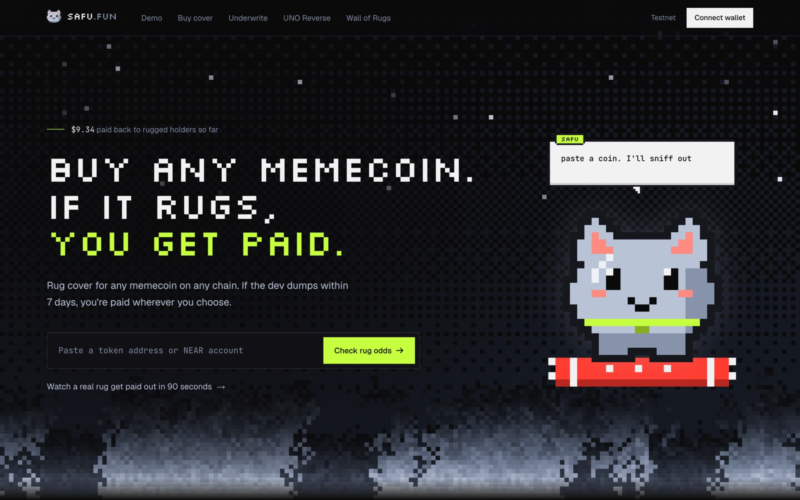
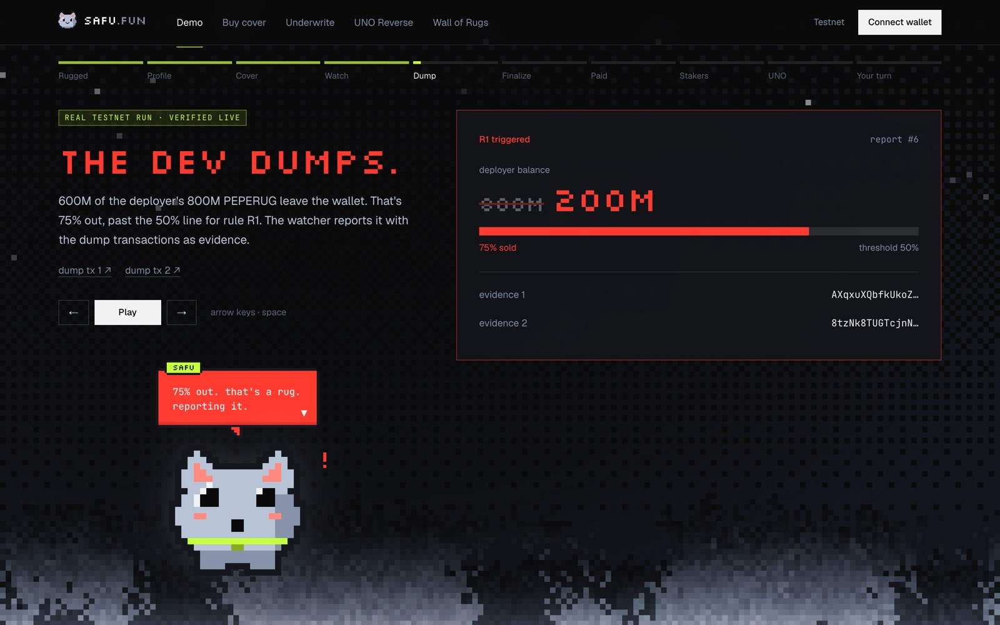
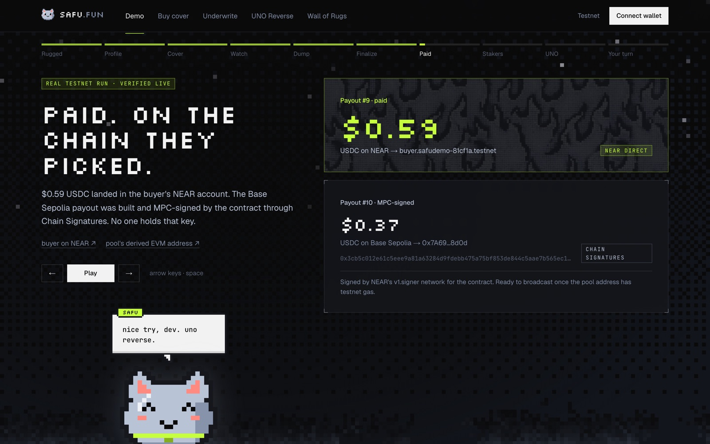
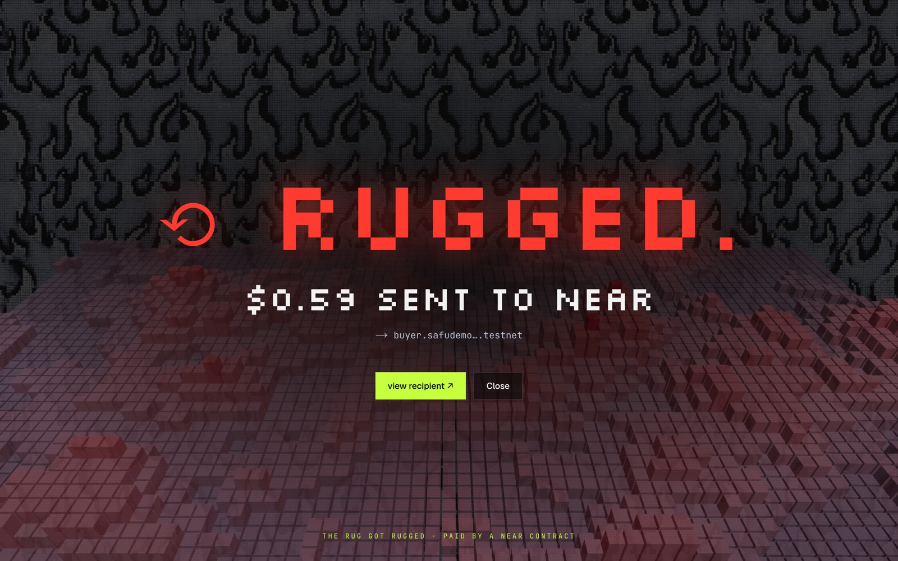
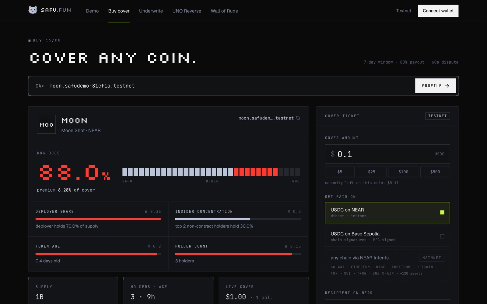
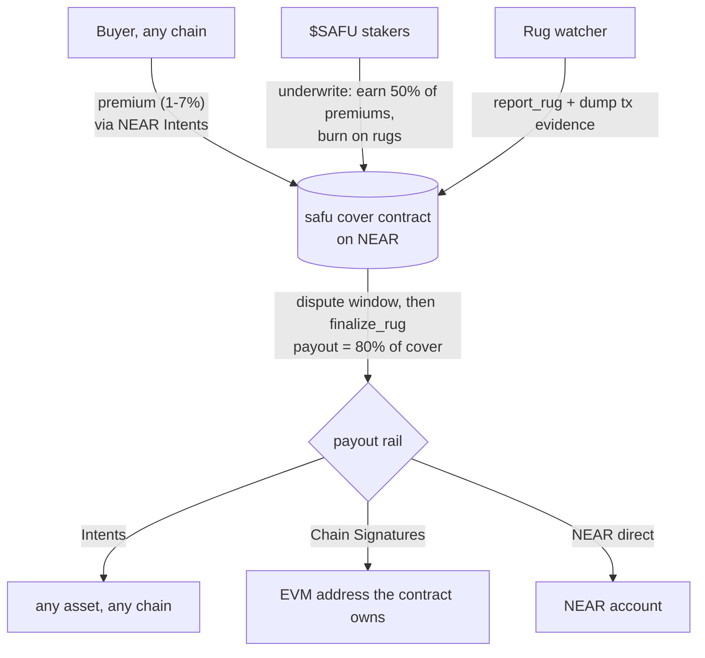

<div align="center">

<a href="https://safu-fun.vercel.app"></a>

### Rug cover for any memecoin, on any chain. When the dev dumps, a NEAR contract pays you back on the chain you pick.

<a href="https://safu-fun.vercel.app/demo"></a>
<a href="https://safu-fun.vercel.app"></a>
<a href="https://testnet.nearblocks.io/address/cover.safufun-d73f3d.testnet"></a>


</div>

---

## The 10-second version

1. **Buy any memecoin, on any chain, with whatever you hold.** Add cover for 1 to 7%.
2. **A watcher tracks the dev and the insiders for 7 days**, against balances locked on-chain before you bought.
3. **If they dump, you get paid back**: 80% of your cover, on the chain and in the asset you chose, sent by a NEAR contract that nobody can override.

**Devs who launch with UNO REVERSE can't rug at all.** Their LP and their bag sit in the contract. If they dump anyway, the contract freezes the pool, refunds every holder and burns the dev's tokens. *When the dev rugs, the liquidity rugs the dev.*

> **No time? [Watch the 90-second demo](https://safu-fun.vercel.app/demo).** It replays a real testnet rug end to end: profiled, covered, dumped, reported, paid out on two chains. Every step links to its transaction.

<p align="center"><a href="https://safu-fun.vercel.app"></a></p>

## The secret

**Chains already pay for rugs. They just do it by hand, after the fact, for whoever they choose.**

When memecoins crashed, BNB Chain and Four Meme paid a **[$45M discretionary "Reload" relief airdrop](https://coinmarketcap.com/academy/article/meme-news-bnb-chain-airdrops-dollar45m-relief-to-meme-traders-bonkinc-launches)** to traders. That is revealed demand for rug cover: money already moving, with no product attached. Meanwhile **[1.8M tokens crashed in Q1 2025 alone](https://tradersunion.com/news/cryptocurrency-news/show/240268-crypto-graveyard-grows)**, and every holder got nothing.

safu.fun turns that airdrop into a product. **Priced up front, paid automatically, on any chain.**

The part that compounds: **a rug-cover market is the best rug detector there is.** Every coin gets a public **rug odds** number, because someone has to price the premium. Honest devs prove they can't rug by launching with UNO REVERSE and get 1% cover instead of 7%. Every other dev now carries a visible rug premium.

## It already happened, on-chain

Not a mockup. This is one run on NEAR testnet, from purchase to payout, with no human steps:

| | What happened | Proof |
|---|---|---|
| 🔎 | **PEPERUG** profiled at **82% rug odds**: the deployer held 80% of supply | [token](https://testnet.nearblocks.io/address/coin-1d3483.rugdev-9a21e0.testnet) |
| 🛡️ | Two policies bought: one pays out on **NEAR**, one on **Base Sepolia** | [buyer](https://testnet.nearblocks.io/address/buyer.safudemo-81cf1a.testnet) |
| 💥 | The dev dumps **600M of 800M** (75% out, past the 50% R1 line) | [dump tx 1](https://testnet.nearblocks.io/txns/AXqxuXQbfkUkoZqCBZqUg3GMkAVFj9C8uVRCb9VHMkZq) · [dump tx 2](https://testnet.nearblocks.io/txns/8tzNk8TUGTcjnNF3uTAbBHtcKA9uqywkkN8sqMzYiHNS) |
| 🚨 | The watcher files **report #6** with the dump txs as evidence. 60s dispute window, no dispute, finalized | [watcher](https://testnet.nearblocks.io/address/watcher.safufun-d73f3d.testnet) |
| 💸 | **$0.59 USDC lands on NEAR.** **$0.37 is MPC-signed for Base Sepolia** by the contract's Chain Signatures address | [contract](https://testnet.nearblocks.io/address/cover.safufun-d73f3d.testnet) |
| 🔥 | $SAFU stakers ate the loss: **71.8M $SAFU burned** in one rug (7.18% loss ratio) | [$SAFU](https://testnet.nearblocks.io/address/safu-token.safufun-d73f3d.testnet) |
| ⟲ | **UNO REVERSE launch #0:** the dev dumped anyway. Pool frozen, **$0.95 refunded** pro-rata, **822M dev tokens burned** | [reverse tx](https://testnet.nearblocks.io/txns/DGuQSzVrGZNJQjLVY6Bd9Q8BGZZUN1QjWqwe6Az72SvB) |

**Live totals:** 9 rugs caught · $9.34 paid back to holders · 15 policies written · no manual steps. Full record in [`deployments/testnet.json`](deployments/testnet.json).

<table>
<tr>
<td width="50%"><a href="https://safu-fun.vercel.app/demo?step=dump"></a><br><sub><b>The dev dumps.</b> The watcher catches R1 and reports with evidence.</sub></td>
<td width="50%"><a href="https://safu-fun.vercel.app/demo?step=paid"></a><br><sub><b>Paid, on the chain they picked.</b> NEAR direct, plus an MPC-signed EVM payout.</sub></td>
</tr>
<tr>
<td width="50%"><a href="https://safu-fun.vercel.app/cover/10"></a><br><sub><b>The payout moment.</b> Policy #10, live.</sub></td>
<td width="50%"><a href="https://safu-fun.vercel.app/buy?chain=near&token=moon.safudemo-81cf1a.testnet"></a><br><sub><b>Price any coin.</b> Rug odds, every factor, the wallets being watched.</sub></td>
</tr>
</table>

## Why only NEAR can do this

| You need to… | NEAR primitive | How safu.fun uses it |
|---|---|---|
| Pay with any asset on any chain | **[NEAR Intents](https://docs.near-intents.org)** (1Click) | The swap routes cross-chain and the premium is taken inside it via `appFees` |
| Hold money and sign payouts *on other chains* from a contract | **[Chain Signatures](https://docs.near.org/chain-abstraction/chain-signatures)** (MPC) | The contract builds the EVM transfer, gets it signed by `v1.signer`, and ecrecovers it against its own derived address. No one holds that key. |
| Pay out in any asset, on any chain | **Intents payout rail** | Pool USDC goes to a 1Click deposit address. The contract verifies 1Click's quote signature on-chain before sending a cent. |
| Tokens, staking, burns | **NEP-141** | $SAFU underwriting, premium share, loss-ratio burns |

> **NEAR is invisible.** The buyer never touches it. They buy on their chain, get paid on their chain, and a NEAR contract made it happen.

## How it works



| Mechanic | What it does |
|---|---|
| **Rug rules** | **R1**: the deployer sells ≥ 50%. **R2**: the top 5 insiders sell ≥ 50%. **R3** (roadmap): LP drops ≥ 80% in an hour. Judged against balances written on-chain *before* cover was sold. |
| **Rug odds** | `premium = clamp(100 + risk × 600, 100, 700)` bps, from deployer share, holder concentration, token age and holder count. Fully public: every quote returns every factor. |
| **Payouts** | 80% of cover (the 20% deductible kills "buy to claim"), pro-rata if the pool is short, per-token exposure capped at 10% of the pool. |
| **$SAFU underwriters** | Stake to earn 50% of every premium in USDC. A finalized rug burns the staked pot by the pool's loss ratio. Stakers eat the rugs. |
| **UNO REVERSE** | Opt-in launches: LP and dev allocation held by the contract, the dev's bag unlocks in tranches. A rug freezes the pool, refunds holders pro-rata and burns the dev's tokens. Cover on UNO coins costs 1%. |

## Trust model, said out loud

| | |
|---|---|
| ✅ **Trustless** | Payout keys are MPC only. Payout amounts are fixed by contract state. 1Click quotes are signature-checked on-chain. Baselines can't be changed while cover is live. |
| ⚠️ **Trusted (beta)** | Rug detection is an allowlisted watcher plus a public dispute window (60s on testnet, 24h in production). |
| 🛣️ **Next** | Attested watchers in NEAR AI Cloud, and a quorum of independent watchers. |

This is a **testnet beta**. The product is called *cover*, not insurance.

## Run it yourself

Frontend and backend are **one Next.js app** in [`web/`](web/). It serves the site, the API at `/api/*`, and runs the watcher and relayer as background jobs.

```bash
pnpm install
cp web/.env.example web/.env.local     # NEAR accounts + quote signing key
pnpm --filter @safu/web dev            # http://localhost:3000
```

Replay the whole thing against testnet yourself (about 3 minutes, no manual steps):

```bash
pnpm --filter @safu/demo services      # terminal 1: site + API + watcher + relayer
pnpm --filter @safu/demo demo          # terminal 2: cover, rug, payout
pnpm --filter @safu/demo uno           # terminal 2: UNO launch, rug, reverse
```

Tests: `cargo test -p safu -p safu-token` (81 contract tests) · `pnpm --filter @safu/web test` (risk model and rug rules).

| Path | What's there |
|---|---|
| [`contracts/safu`](contracts/safu) | The cover contract (Rust, near-sdk): policies, pool, rug lifecycle, three payout rails, $SAFU staking, UNO REVERSE |
| [`contracts/safu-token`](contracts/safu-token) | $SAFU, NEP-141 with burn |
| [`web/`](web/) | Next.js app: every screen, plus [`src/server`](web/src/server/README.md), which holds the API, rug watcher and relayer |
| [`scripts/demo`](scripts/demo) | End-to-end testnet runs: deploy a memecoin, cover it, rug it, get paid |
| [`deployments/testnet.json`](deployments/testnet.json) | Every account, upgrade and recorded run |
| [`PRD.md`](PRD.md) | The full spec |

<details>
<summary><b>Contract deep dive: the full lifecycle</b></summary>

<br>

Build: Rust (stable), `wasm32-unknown-unknown`, [`cargo-near`](https://github.com/near/cargo-near). `cd contracts/safu && cargo near build non-reproducible-wasm`.

1. Pool is funded with NEAR USDC via `ft_transfer_call(msg: "fund" | "premium")`.
2. Cover is sold two ways: **Intents buy** (mainnet, 1Click-listed coins: premium taken via `appFees`, API registers the policy on swap SUCCESS) or **cover-only** (any coin: buyer pays the premium in USDC with `ft_transfer_call` carrying an API-signed quote, which the contract verifies before creating the policy). Premium 1-7% from rug odds; per-token exposure ≤ 10% of pool.
3. Before cover is sold, the API records a **token watch** on-chain (deployer + insiders with baseline balances, locked while cover is live). The allowlisted watcher re-reads those balances, and on R1/R2 calls `report_rug(token, rule, evidence)` with the dump tx hashes → dispute window.
4. Anyone calls `finalize_rug(report_id)` after the window → payouts queued at 80% of cover (pro-rata if pool is short).
5. **Rail A**: relayer calls `request_payout_intents(payout_id, quote, quote_signature)` with a live **1Click-signed quote**. The contract verifies the signature on-chain (`ed25519_verify` against the 1Click manager key) and that the quote pays this payout's amount/asset/recipient and refunds to the contract, then sends USDC to the deposit address in the quote → swapped to the user's asset on the user's chain → `mark_paid(payout_id, dest_tx_hash)`.
6. **NEAR-direct**: payouts on NEAR in pool USDC: anyone calls `request_payout_near(payout_id)` and the contract sends USDC straight to the recipient.
7. **$SAFU underwriters**: stake with `ft_transfer_call(msg: "stake")` to earn 50% of every premium in USDC (`claim_rewards`). When a rug is finalized the staked pot is **burned** by the pool's loss ratio (payout ÷ pool capital, ≤50% per rug) via `ft_burn`: stakers eat the rugs, and $SAFU supply shrinks. Unstaking unbonds for longer than the dispute window and stays slashable while unbonding.
8. **UNO REVERSE**: a dev opts in with `create_uno_launch`, locks their allocation (unlocks in tranches) and seeds a constant-product pool **owned by the contract**: nobody, the dev included, can pull it. UNO coins get ~1% cover. When a rug on the coin is finalized, the launch is reversed: pool frozen, its USDC becomes a refund pot, the dev's locked remainder and the pool's coin are burned (`ft_burn`), the watcher posts the holder snapshot on-chain (dev/insiders excluded) and pro-rata USDC refunds are pushed to every holder. On NEAR the contract is the custodian; on other chains the same role is the Chain Signatures address for path `uno-<id>`.
9. **Rail B**: relayer calls `request_payout_signed(payout_id, max_fee_per_gas, max_priority_fee_per_gas)`. The **contract** builds the EIP-1559 `USDC.transfer(recipient, amount)` tx (chain id, token, recipient, amount and nonce are fixed by contract state; gas price is capped), asks `v1.signer` for an Ecdsa signature on path `pool-<chain>`, **ecrecovers it against the pool's derived address**, and stores the raw signed tx + its hash on the payout. Anyone can broadcast it; `mark_paid` only accepts that exact tx hash. Re-signing (gas bump) reuses the same nonce, so a payout can never land twice.

Deployed at [`cover.safufun-d73f3d.testnet`](https://testnet.nearblocks.io/address/cover.safufun-d73f3d.testnet), upgraded in place through v0.9 with state preserved. Accounts and history are in [`deployments/testnet.json`](deployments/testnet.json).

</details>

## Built for the NEAR Hackathon

**[nearhackathon.com](https://nearhackathon.com)** · Tracks: **Memecoins With Mechanics** · Investment Thesis · Unstoppable DeFi · AI Security & Defense

<div align="center">
<br>
<a href="https://safu-fun.vercel.app/demo"></a>

**funds are safu.**

<sub><a href="https://safu-fun.vercel.app">safu-fun.vercel.app</a> · <a href="https://safu-fun.vercel.app/demo">90-second demo</a> · <a href="https://safu-fun.vercel.app/wall">Wall of Rugs</a></sub>
</div>
